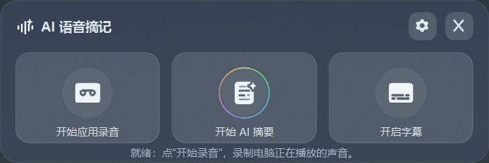

# AI 语音摘要（本地 ASR + 多模型 LLM）

Windows 桌面工具：采集系统正在播放的声音 → 本地双模型流式转写 → 大模型生成结构化摘要。
**音频全程不出本机**，只有“生成摘要”这一步会把转写文本发给你自己配置的模型 API。

## 功能

- **系统音频回环采集**：基于 WASAPI loopback（pyaudiowpatch），不需要装虚拟声卡，也不需要 ffmpeg。
- **双模型转写**：Paraformer 流式出草稿字幕，VAD 端点检测后由 SenseVoice 出定稿文本，边听边出字。
- **长音频自动分段**：默认每 20 分钟切一段，避免长序列推理的内存与延迟劣化。
- **多模型摘要**：统一 LLM 适配层，DeepSeek / Qwen / GLM / Kimi / Ollama 可切换；配置驱动、流式输出。
- **桌面交互**：托盘常驻、字幕窗置顶，字号 / 行数 / 透明度 / 位置可调。

## 实测指标（单机 CPU 推理）

| 指标 | 数值 |
|---|---|
| 端点检测 → 定稿字幕 | **371 ms** |
| 双模型同时驻留内存 | **≈704 MB** |
| 本地 INT8 模型总体积 | **≈531 MB** |
| 转写云成本 | 0（全部本地推理） |

## 链路

```
WASAPI 环回 ──► 环形缓冲 ──► Silero VAD ──┬─► Paraformer 流式（草稿字幕，实时）
                                          └─► SenseVoice 定稿（最终文本，端点触发）
                                                       │
                                             每 20 分钟分段 ──► LLM 适配层 ──► Markdown 摘要
```

## 目录结构

```
run.py                  启动入口
start.bat               一键启动
requirements.txt
config.example.json     配置模板（复制为 config.json 后填入自己的 Key）
sysrec/
  capture.py            WASAPI 环回采集
  stream_asr.py         流式草稿识别
  asr.py                定稿识别 + 分段
  punctuate.py          标点与术语修正
  llm.py                多模型适配层（统一接口 / 流式 / 重试）
  gui.py / panel.py     主界面与托盘
  subtitle_window.py    置顶字幕窗
  records / transcript / encoder    录音落盘与转写文件
models/                 模型目录（不入库，按下方说明下载）
```

## 快速开始

```bash
# 1) 环境：Windows 10/11 + Python 3.13
python -m venv venv
venv\Scripts\pip install -r requirements.txt

# 2) 配置：复制模板并填入自己的 API Key
copy config.example.json config.json

# 3) 启动
python run.py
```

## 模型下载

四个目录放在 `models/` 下，均为 [sherpa-onnx](https://github.com/k2-fsa/sherpa-onnx) 官方发布的 INT8 模型（见其 releases 的 `asr-models` / `vad-models` 标签）：

| 目录 | 用途 | 模型 |
|---|---|---|
| `models/sense-voice-small/` | 定稿识别 | SenseVoice Small（`model.int8.onnx` + `tokens.txt`） |
| `models/streaming-paraformer/` | 流式草稿 | Streaming Paraformer 双语（`encoder/decoder.int8.onnx` + `tokens.txt`） |
| `models/vad/` | 端点检测 | Silero VAD（`silero_vad.onnx`） |
| `models/punct/` | 标点恢复 | CT-Transformer 中英标点（`model.int8.onnx` + `tokens.json`） |

## 隐私与仓库约定

- `config.json`（含 API Key）、`录音/`、`转写/`、`摘要/`、`models/` 均已写入 `.gitignore`，**不会进入仓库**。
- 转写与摘要只写本地磁盘；除摘要请求外无任何外发流量。

## 已知限制

- 仅支持 Windows（依赖 WASAPI 环回采集）。
- 模型文件较大，不随仓库分发，需按上表自行下载。
- 摘要质量依赖所选模型；分段摘要对跨段引用（如“上面提到的三个问题”）还原有限。
